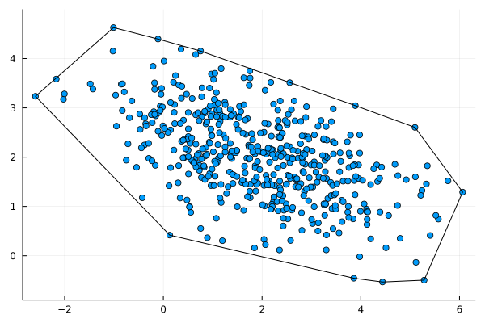
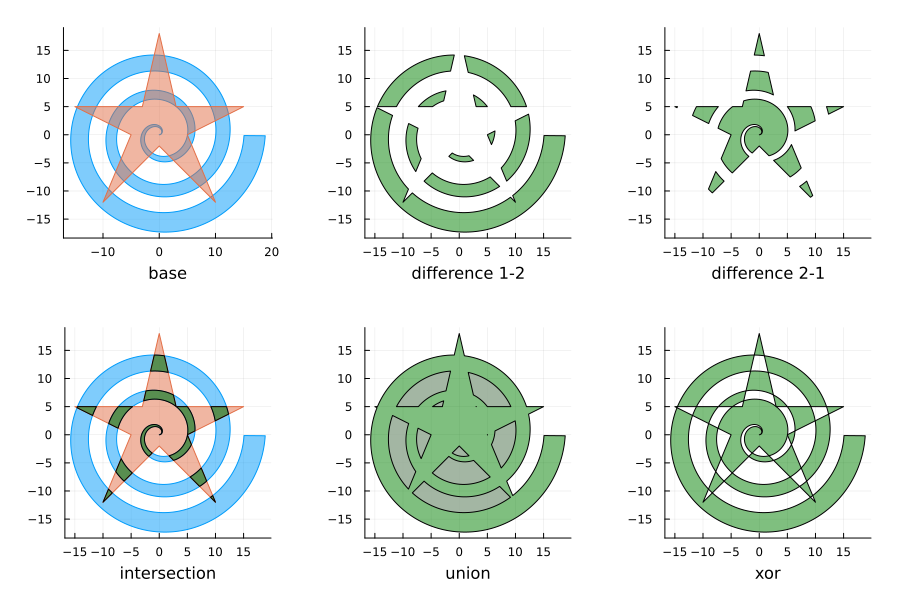
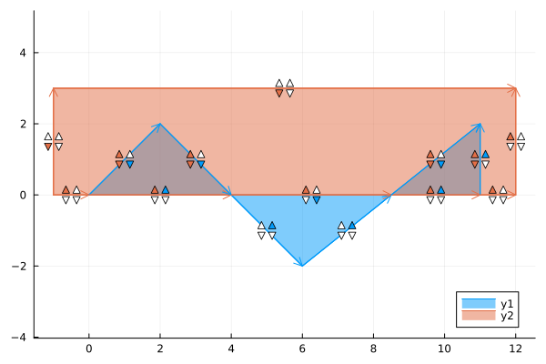
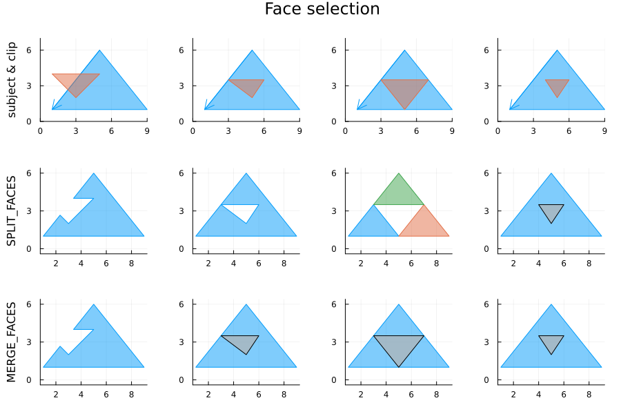
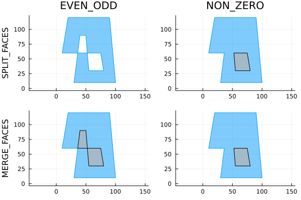
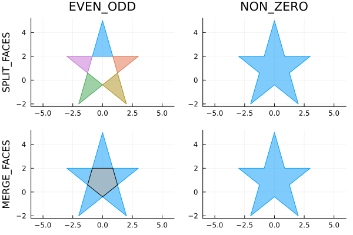
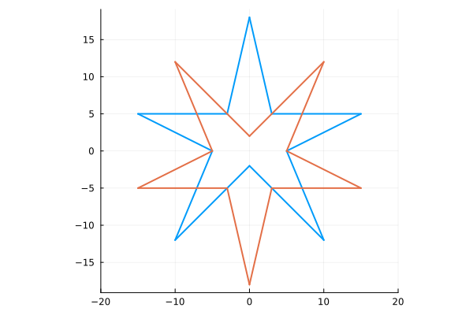
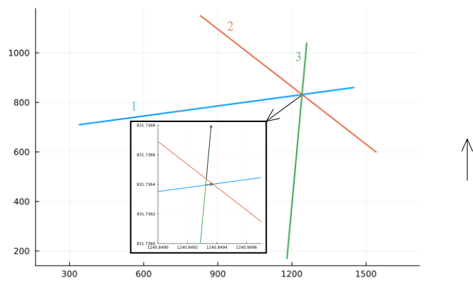

# Polygon Algorithms

1. [Description](#description)
    1. [Example](#example)
    1. [Representation](#representation)
1. [Polygon Functions](#polygon-functions)
1. [Segments to Paths](#segments-to-paths)
1. [Fill rules](#fill-rules)
1. [Robustness](#Robustness)
1. [Installation](#installation)
1. [Related](#related)

Implementations of Polygon algorithms.

<p align="center">
  
   
</p>

## Description
### Example

```julia
using PolygonAlgorithms
using PolygonAlgorithms: x_coords, y_coords

poly = [
    (0.4, 0.5), (0.7, 2.0), (5.3, 1.4), (4.0, -0.6)
]
area_polygon(poly) # 7.855
contains(poly, (2.0, 0.5)) # true
contains(poly, (10.0, 10.0)) # false

poly2 = [
    (3.0, 3.0), (4.0, 1.0), (3.0, 0.5), (2.0, -0.5), (1.5, 0.9)
]
intersection = intersect_geometry(poly, poly2)

using Plots
idxs = vcat(1:length(poly), 1)
plot(x_coords(poly, idxs), y_coords(poly, idxs))
```

### Representation

There are several ways to represent polygons:
- As a path given as a vector of points (tuples). The last point is assumed to share an edge with the first: `n + 1 = 1`.
    - For indexing use `x_coords` and `y_coords`. 
- With the internal `PolygonAlgorithms.Polygon` struct. This struct consists of an `exterior` and `holes`. Each sub-object must be a list of points (tuples). The holes should be properly contained in the polygon.
Validation is not performed by default. Pass `validate=true` to the constructor to enable it.
- As a list of segments. This representation naturally allows multi-polygons and holes. 
It is used internally for algorithms including the `martinez_rueda_algorithm`. Graph face computation is used to link segments back to a path. See the [Segments to paths](#segments-to-paths) section for more detail.
- As a 2&times;N matrix for `N` points. This is not used here, but can be more efficient for indexing and broadcasting operations such as translation and rotation. To convert to this representation and back, use `matrix_to_points` or `points_to_matrix`.

## Polygon Functions

Common broadcasting operations are supplied such as `translate` and `rotate`.

For all of the the following `n` and `m` are the number of vertices of the polygons.

1. `area_polygon`, `centroid_polygon`, `first_moment`, `is_clockwise`, `is_counter_clockwise`
    - Operations: area of polygon, centroid of polygon, polygon direction.
    - Algorithm: Shoe-lace formula.
    - Time complexity: `O(n)`.
    - Reference: [Wikipedia](https://en.wikipedia.org/wiki/Polygon#Area).
2. `bounds`
    - Operation: bounding rectangle of a polygon.
    - Algorithm: linear search.
    - Time complexity: `O(n)`.
3. `contains`
    - Operation: point in polygon.
    - Algorithm: Ray casting with an extension from the following paper: "A Simple and Correct Even-Odd Algorithm for the Point-in-Polygon Problem for Complex Polygons" by Michael Galetzka and Patrick Glauner (2017).
    - Time complexity: `O(n)`. 
    - Reference: [Wikipedia](https://en.wikipedia.org/wiki/Point_in_polygon), [paper](https://arxiv.org/abs/1207.3502).
4. `convex_hull`
    - Operation: minimum convex hull around a set of points.
    - Gift-wrapping algorithm:
        - Time complexity: `O(nh)` where `h` is the number of points in the hull.
        - Reference: [Wikipedia](https://en.wikipedia.org/wiki/Gift_wrapping_algorithm).
    - Graham Scan algorithm:
        - Time complexity: `O(n*log(n))`.
5. `any_intersect`
    - Operation: find if there any intersections of segments in a plane. Optionally, ignore vertex intersections, which is useful for polygon self-intersections.
    - Algorithm: Shamos-Hoey algorithm which does a line sweep.
    - Time complexity: `O(n*log(n))` where `n` is the number of segments.
    - Reference: [ "17th Annual Symposium on Foundations of Computer Science (sfcs 1976)"](https://euro.ecom.cmu.edu/people/faculty/mshamos/1976GeometricIntersection.pdf).
6. `intersect_convex`
    - Operation: intersection of convex polygons (polygon clipping). 
    - Chasing edges algorithm (default):
        - Convex only.
        - From "A New Linear Algorithm for Intersecting Convex Polygons" (1981) by Joseph O'Rourke et. al.
        - Time complexity: `O(n+m)`.
        - Reference: https://www.cs.jhu.edu/~misha/Spring16/ORourke82.pdf
    -  Point search algorithm:
        - Convex only.
        - Combines point in polygon algorithm with intersection of edges.
        - Time complexity: `O(nm)`.
        - For general non-self-intersecting polygons, the intersection points are valid but the order is not.
    - Martinez-Rueda algorithm (default):
        - See point 8.
    - Weiler-Atherton algorithm:
        - See point 7.
7. `intersect_geometry`
    - Operation: Intersection of polygons (polygon clipping).
    - Martinez-Rueda algorithm (default).
        - See point 8.
    - Weiler-Atherton algorithm:
        - Concave and convex but not self-intersecting.
        - Time complexity: `O(nm)`. 
        - For a full explanation, see my [blog post](https://liorsinai.github.io/mathematics/2023/09/30/polygon-clipping.html).
8. `difference_geometry`, `intersect_geometry`, `union_geometry`, `xor_geometry`
    - Operation: boolean operations on polygons.
    - Algorithm: Martinez-Rueda.
    - Concave, convex and self-intersecting with holes. Can operate on multiple polygons at once.
    - Annotates each segments with 4 fill criteria: filled by itself above and/or below, and filled by the other polygon above and/or below. Once this has been accomplished, it is trivial to select segments which match the given operation. These segments are then combined to form the final polygon(s). See the section [Segments to paths](#segments-to-paths) for more detail. 
    - Time complexity: `O((n+m+k)log(n+m))`. 
    - Reference: https://www.researchgate.net/publication/220163820_A_new_algorithm_for_computing_Boolean_operations_on_polygons
    - Blog post: https://sean.fun/a/polygon-clipping-pt2/
    <p align="center">
    
   </p>

## Segments to paths

Segments are converted back to paths and polygons by computing the faces of a graph. This has several implications.
- It requires matching the starting and end points of segments, which may differ by floating point error. End points within half of `1e-6` of each other are matched to the same point. The output points are not rounded.
- Every zero area polygon (lines) will return a single face. 
- For every non-zero area polygon, the graph will always have one counter-clockwise exterior and one or more clockwise interiors. Every area in the graph is therefore counted twice. There are two methods to reduce the faces in half:
    - `MERGE_FACES`: all exterior faces that are not holes and holes are interior faces that are holes.
    - `SPLIT_FACES`: all interior faces that are not holes that are on the exterior and interior faces that are holes that are not on the exterior.

The following is a comparison of the two while running `difference(subject, clip; face_selection=method)`:
<p align="center">
  
</p>

The functions which implement this are `PolygonAlgorithms.segments_to_paths` and `PolygonAlgorithms.segments_to_polygons`.

## Fill Rules

There are different rules to determine whether or not the interior of a self-intersecting polygon is considered inside the polygon or a hole.
The Martinez-Rueda algorithm here implements the common even-odd and non-zero fill rules, as will as the less used positive and negative fill rules.

These rules are based on the winding number for each interior which is calculated as follows:
1. Construct a ray heading out from a given point `P` in any direction towards infinity.
1. Find all the intersections of the contour `C` with this ray. 
1. Score up the winding number as follows:
    - for every clockwise intersection (line heading left to right through the ray) subtract 1.
    - for every counter-clockwise intersection (line heading right to left through the ray) add 1.
1. Use the winding number to determine if filled or not.
    - `EVEN_ODD`: alternative between filled and not filled.
    - `NON_ZERO`: non-zero windings are filled.
    - `POSITIVE`: only positive windings are filled (top to bottom ray).
    - `NEGATIVE`: only negative winding are filled (top to bottom ray).

Here is are examples of the even-odd and non-zero rules combined with the different face selection strategies:
<p align="center">
  
   
</p>

See https://www.angusj.com/clipper2/Docs/Units/Clipper/Types/FillRule.htm and https://en.wikipedia.org/wiki/Nonzero-rule.

## Robustness

Mathematically, the algorithms are infinitely precise.
Practically, this code works with floats, which have rounding errors.
The philosophy of this package is that tolerances only absorb floating point error.

There is a single relative tolerance `rtol` that is passed down as a keyword argument throughout the entire algorithm.
Its default value depends on the float type: `PolygonAlgorithms.default_rtol(T) = 64eps(T)`.
This is `1.4e-14` for `Float64` and `7.6e-6` for `Float32`.
A computed value `x` is treated as zero if `|x| ≤ rtol * Σ|terms|`, where the terms are the values that were added or subtracted to calculate `x`.

Previous versions used an absolute tolerance `atol` as a distance, with a default of `1e-6`.
A larger `atol` was expected to "fudge" results into simpler polygons.
Instead the useful range was limited by the size of the smallest features of the polygons, and larger values mostly caused errors in the Martinez-Rueda algorithm.
This is because fuzzy comparisons are not transitive: `A ≈ B` and `B ≈ C` does not mean `A ≈ C`.
The Martinez-Rueda algorithm maintains a precise order of segments and their intersections, and fails if these comparisons contradict each other.
With floating point tolerances, the comparisons are exact whenever the sign of the computed value can be trusted.

The tolerance can still be increased, but this is not recommended.
Here are the results of the 195 [Clipper2](https://github.com/AngusJohnson/Clipper2) tests for different values of `rtol`:

| `rtol` | Pass | Fail or error |
|---|---|---|
| `64eps = 1.4e-14` (default) | 195 | 0 |
| `1e-12` | 195 | 0 |
| `1e-9` | 194 | 1 |
| `1e-6` | 185 | 10 |
| `1e-4` | 122 | 73 |

To simplify the output polygons, round the co-ordinates of the input before running the algorithm instead.

[Clipper2](https://www.angusj.com/clipper2/Docs/Robustness.htm) has a different approach to robustness: it casts all numbers to integers.
Hence for multiple lines, like the case study below, intersections will be collapsed to a single point, and the segments adjusted slightly.
This means that the two halves of each segment will no longer lie perfectly on a straight line.

### Sources of floating point error

There are two sources of error:
1. Arithmetic error. Each floating point operation has a relative error of at most `u = eps(T)/2`.
For example, the cross product `L - R` of three points is a difference of two products.
Jonathan Shewchuk showed that its error is at most `(3u + 16u²) * (|L| + |R|) ≈ 1.5eps * (|L| + |R|)`.
See "Adaptive Precision Floating-Point Arithmetic and Fast Robust Geometric Predicates" (1997).
The bound is relative to `|L| + |R|`, not `|L - R|`, so it is meaningful for nearly colinear points, where `L` and `R` are large and almost cancel.
2. Representation error. Shewchuk's bound assumes the points are exact.
But intersection points are calculated, so their co-ordinates are rounded to within about `u * |x|`.
So an intersection point does not lie exactly on either segment.
This error is relative to the size of the co-ordinates, not the size of the segments.
It is important for short segments far from the origin.
The input points may also have been calculated, for example by rotation.
Their error is relative to the size of the numbers in that calculation, which can be larger than the point itself.
For example, rotating the Hilbert curve in `examples/hilbert.jl` about `(0.5, 0.5)` moves points near the origin by up to `5.6e-17`, which is `6eps` relative to a point at `0.04`.
This is why the default `rtol` is `64eps` rather than a bound closer to Shewchuk's `1.5eps`.
That example is only correct for `rtol ≥ 32eps`.

### Tolerance tests

Core functions that use `rtol` include:

| Function | Test | Meaning |
|---|---|---|
| `is_same_point(p, q)` | `\|p - q\|² ≤ rtol² * max(\|p\|², \|q\|²)` | Points are equal up to the rounding of their co-ordinates. |
| `get_orientation(p, q, r)` | `\|L - R\| ≤ rtol * (\|L\| + \|R\| + scale * side)` | Colinear if the cross product `L - R` is within arithmetic and representation error. `scale` is the largest absolute co-ordinate and `side` is the longest side of the triangle, using the Manhattan distance `\|Δx\| + \|Δy\|`. Symmetric in `p`, `q` and `r`. |
| `on_segment(r, segment)` | colinear and inside the bounding box expanded by `rtol * scale` | `scale` is the largest absolute co-ordinate, as in `get_orientation`, so both tests use the same representation error. |
| `is_vertical(segment)` | `\|Δx\| ≤ rtol * max(\|x₁\|, \|x₂\|)` | |
| `intersect_geometry(segment1, segment2)` | orientations of the end points, as in `do_intersect` | No intersection if both end points of one segment are on the same side of the other. Parallel if both end points of one segment are colinear with the other. If an end point is colinear with the other segment, it is returned exactly. Otherwise the intersection is calculated and clamped to `segment1`. |
| `is_clockwise`, `is_counter_clockwise` | `\|area\| ≤ n * rtol * Σ(\|xᵢyᵢ₊₁\| + \|yᵢxᵢ₊₁\|) / 2` | Zero area within floating point error: neither direction, and dropped from boolean results. The error of a sum of `n` terms grows at most linearly with `n`. |
| `segments_to_paths` | `\|Δx\| ≤ 0.5e-6` and `\|Δy\| ≤ 0.5e-6` | End points of segments are matched to the first point within half of `1e-6`. This does not depend on `rtol`. The output points are not rounded. Rounding alone does not work: points which differ by floating point error can round in different directions, e.g. `0.0078125 ± 1e-17` to 6 decimal places. |

Notes:
- `intersect_geometry` uses the same orientations as `do_intersect` so that they always agree. Returning end points exactly avoids creating tiny segments from an intersection point which was calculated a few ulps away from a vertex.
- In the Martinez-Rueda algorithm, an intersection point is clamped to one segment but can be a few ulps past the end of the other segment. So the point is classified by the sweep order (see `PolygonAlgorithms.classify_intersection`): a point at or before the start of a segment is treated as the start and a point at or after the end is treated as the end.
- `on_segment`: The simpler bound box check is done rather than determining if the closest point is within the tolerance of the segment.
- For the line method of `intersect_geometry`, lines are parallel if `|det| ≤ default_rtol(T) * (|a₁b₂| + |a₂b₁|)`.

### Case studies

In the first example, the tolerances are essential to avoid failure:

<p align="center">
  
</p>

The polygons are defined by:
```julia
polygon1 = [
    (0.0, 18.0), (3.0, 5.0), (15.0, 5.0), (5.0, 0.0), (10.0, -12.0), 
    (0.0, -2.0), (-10.0, -12.0), (-5.0, 0.0), (-15.0, 5.0), (-3.0, 5.0)
]
polygon2 = PolygonAlgorithms.rotate(polygon1, π/1.0, (0.0, 0.0));
```

Note that the second polygon is computationally rotated. 
This is numerically accurate up to approximately `eps(Float64)=2.2e-16` times the size of the coordinates, which is about `4e-15` here.
Therefore, the points will not exactly align.
This is a representation error, so it is covered by the default tolerance.
`intersect_geometry(polygon1, polygon2)` returns a single region with an area of `102.83` for every `rtol` from the default to `1e-6`.

In the next example, a large tolerance is the cause of the failure.
This example is from [Clipper2: test 141](https://github.com/AngusJohnson/Clipper2/blob/main/Tests/Polygons.txt):

<p align="center">
  
</p>

These segments are defined by:
```julia
segment1 = ((340.0, 710.0), (1450.0, 860.0))
segment2 = ((830.0, 1150.0), (1540.0, 600.0))
segment3 = ((1180.0, 170.0), (1260.0, 1040.0))
```

These segments look like they intersect at a single point. 
However, upon magnification by a factor of 1.5 million, it is evident that they intersect at 3 different points.
The two black segments - the top half of `segment3` (green) and a middle section of `segment1` (blue) - at this magnification do not intersect.
Note that the top half of `segment3` (length ~209) is much longer than the middle section of `segment1` (length ~5e-5).
With the default tolerance, they correctly do not intersect.
For `rtol ≥ 1e-7`, the end points of the short section are colinear with the top half of `segment3` within tolerance, so `do_intersect` reports that they touch.
This incorrect classification can then cause the Martinez-Rueda algorithm to fail, and test 141 fails for `rtol = 1e-6`.

## Installation

In the Julia REPL:
```
julia> ] #enter package mode
(@v1.x) pkg> add PolygonAlgorithms
julia> using PolygonAlgorithms
```

Optionally, tests can be run with:
```
(@v1.x) pkg> test PolygonAlgorithms
```

For local development: download the GitHub repository. Then in the Julia REPL:
```
julia> ] #enter package mode
(@v1.x) pkg> dev path\\to\\PolygonAlgorithms
julia> using Revise # allows dynamic edits to code
julia> using PolygonAlgorithms
```

## Related

- [PolygonOps](https://github.com/JuliaGeometry/PolygonOps.jl)
- [PolygonClipping](https://github.com/JuliaGeometry/PolygonClipping.jl)